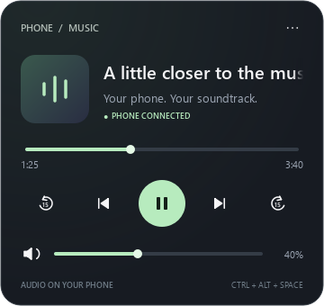

# Phone Playback

Your phone's music, a glance away.

A compact Windows taskbar and tray remote for Android media through **KDE Connect**. A scrolling title strip stays along the taskbar; hover to reveal album art, playback controls, seeking and phone volume. Move away and the panel disappears.



**Early preview · Windows x64 only · KDE Connect required.** A downloadable installer bundles Python and the UI runtime. It controls playback on the phone; it does not stream phone audio to the PC.

## Install

Download **[PhonePlayback-Setup-0.2.0-win-x64.exe](https://github.com/KigoJomo/phone-playback/releases/download/v0.2.0/PhonePlayback-Setup-0.2.0-win-x64.exe)** from the [release page](https://github.com/KigoJomo/phone-playback/releases/tag/v0.2.0). The per-user installer needs no administrator access or separate Python installation. It provides optional desktop and login-startup shortcuts, plus a standard Windows uninstaller. Builds are currently unsigned; SHA-256 checksums are included with each release.

Requirements:

- Windows 10 or 11 x64. Tested locally on Windows 10; Windows 11 and physical mixed-DPI monitor arrangements are not yet verified.
- [KDE Connect](https://kdeconnect.kde.org/download.html) installed and running on both PC and Android phone, already paired and reachable.
- Phone media control enabled in KDE Connect, including any permission the Android app requests.

For a source installation, install Python 3.11 or later, clone this repo, then run from its directory:

```powershell
python -m venv .venv
.\.venv\Scripts\python.exe -m pip install -e .
.\.venv\Scripts\pythonw.exe -m phone_playback
```

Alternatively, `./install.ps1` performs the same steps and creates a desktop shortcut. It does not enable login startup.

The app automatically chooses a phone when exactly one paired phone is reachable. If several are available, use **right-click → Choose phone**. The source name at the top of the panel selects a player. Start playback on the phone to make a session available.

KDE Connect's installer and Microsoft Store paths are detected. If detection fails, set `KDECONNECT_BIN` to the existing installation's `bin` directory containing `dbus-1-3.dll` and relaunch. The Store path is detected but not yet tested on a clean Store installation.

## Use

- Hover over the title strip to expand the controls. Move away to dismiss them.
- The strip finds a gap between taskbar controls using a read-only accessibility scan. If there is no room, it uses the tray instead of covering buttons. It overlays the taskbar and **does not reserve space** or modify Explorer.
- Drag the strip to your preferred display/taskbar area, or use **Taskbar display**. Placement is remembered per monitor and recalculated when taskbar contents or monitor geometry change. If the monitor is disconnected, it falls back to an available display.
- Click the green equalizer tray icon to open controls; middle-click toggles playback. Windows may initially hide it behind the **^** arrow.
- Right-click for phone selection, tray-only mode or Quit.
- **Start with Windows** is optional and off unless enabled in the installer or menu. It uses only this application's per-user Run entry.
- **Follow active player** switches to a session when it starts playing, without interrupting playback. Manually choosing a player locks to it; choose Follow again to unlock. If a locked player disappears, controls are disabled rather than sent to another player. Ambiguous duplicate identities are ignored.
- Scroll over the strip or panel to adjust volume by 5% per notch. **Shift+scroll** seeks by 10 seconds per notch when supported. High-resolution wheel input accumulates smoothly, with transient feedback.
- **Theme colour → Follow Windows accent** uses the Windows colour scheme by default and updates when it changes. **Choose custom colour…** opens a colour picker; your choice is saved between launches. **Album artwork** derives a restrained accent from the current local cover image and falls back to Windows when artwork is missing. Existing colour preferences are preserved. The accent applies to playback, sliders, the tray icon and the panel glow.
- The speaker icon follows the phone-reported volume: muted, low, medium or high.
- The strip hides for a foreground fullscreen app on its display. Vertical taskbars, inaccessible taskbar layouts and crowded taskbars use the tray or shortcuts.
- Playback and volume controls act on the selected phone, not on the PC.

| Shortcut | Action |
| --- | --- |
| Ctrl + Alt + Space | Play / pause |
| Ctrl + Alt + Left / Right | Previous / next |
| Ctrl + Alt + Up / Down | Phone volume ±5% |
| Ctrl + Alt + M | Show / hide controls |

Shortcuts work while the app runs. Conflicting shortcuts are reported in Options. Settings are stored in `%LOCALAPPDATA%/PhonePlayback/settings.json`, outside the checkout. This app does not enable new phone permissions, pair devices or change the firewall.

## Does it work with every player?

**No universal compatibility claim.** Players must expose an Android media session that KDE Connect can see. Controls depend on the player, content, Android version and KDE Connect version. A website in a browser must expose a media session too. Live streams often cannot seek.

| Feature | Requirement / status |
| --- | --- |
| Track metadata and album art | Whatever KDE Connect receives from the selected session |
| Play / pause and previous / next | Player must implement those transport actions |
| ±15 seconds and seek slider | `canSeek` and a known duration; positions use milliseconds |
| Volume | Player's Android media-session volume support |
| Like / save / favorite | **Unavailable through the current KDE Connect media D-Bus interface** |

OpenTune playback and seeking, per-player state discovery and native taskbar scanning have been checked on one phone/PC setup. Automatic switching with multiple phone players and mixed-monitor layouts have deterministic tests; broader hardware/player verification is still needed. VLC and Brave are intended to work when they expose compatible sessions, but have not yet been validated on that phone. Spotify, YouTube Music and other players are not certified or individually tested. iOS, macOS and Linux are not supported by this Windows implementation.

### Why isn't there a Like button?

Even if a player supports likes internally, KDE Connect's current Android receiver and desktop D-Bus media interface do not expose ratings, favorites or custom media actions. Sending a made-up `Like` action would silently do nothing. A real implementation needs an upstream KDE Connect extension or a separate, authenticated player-specific adapter. This release does not simulate a like or store a local heart that looks like it saved the track.

### Seeking implementation

KDE Connect's desktop plugin exposes relative `Seek`, but its current Android receiver handles absolute `SetPosition`. Both seek buttons therefore calculate a bounded absolute position in milliseconds, using an elapsed-time clock between metadata updates. The buttons and slider are disabled when seeking is unavailable.

## Development

```powershell
.\.venv\Scripts\python.exe -m unittest discover -s tests -v
$env:QT_QPA_PLATFORM = 'offscreen'
.\.venv\Scripts\python.exe -m phone_playback --preview
```

The preview uses demo metadata and placeholder artwork, never a live listening history. UI tests render local widgets offscreen; they do not operate the desktop. `ci/windows-checks.yml` is an Actions template for Python 3.11 and 3.13. CI is not currently enabled: the publishing sign-in lacks GitHub's `workflow` scope. To enable it with an appropriately authorized account, copy the template to `.github/workflows/check.yml` and commit. CI does not replace testing on real paired phones.

### Build the installer

On Windows x64, install [Inno Setup 6](https://jrsoftware.org/isinfo.php), then:

```powershell
.\.venv\Scripts\python.exe -m pip install -e ".[build]"
.\.venv\Scripts\python.exe tools/build_release.py
```

The build produces `release/PhonePlayback-Setup-0.2.0-win-x64.exe` and `SHA256SUMS.txt`. It freezes the app into an on-disk directory of replaceable DLLs and builds a per-user Inno Setup installer. The build downloads pinned upstream license texts; it never bundles credentials, local configuration or KDE Connect binaries. Its DLL search path is isolated from unrelated tools in the developer's PATH.

A packaged-runtime smoke check is available without sending input to the desktop or changing playback:

```powershell
PhonePlayback.exe --self-test --self-test-report report.json
```

It checks the tray, taskbar scanner and existing local KDE Connect bus. It does not install KDE Connect or grant permissions.

## Privacy and dependencies

No web server, analytics or music-service account. Communication uses the existing local KDE Connect session bus and its already-paired connection. Device configuration stays in the per-user settings file. Credentials, device IDs, installed dependency binaries and cached album art are not part of this repository.

The application source is MIT licensed. PySide6/Qt, libdbus and KDE Connect retain their own licenses. The installer includes Python, PySide6/Qt and comtypes, with license texts in `third-party-licenses/`. Source installs use the declared dependencies. libdbus is loaded from the user's existing KDE Connect installation. See [third-party notices](THIRD_PARTY_NOTICES.md). No KDE Connect binaries or code are redistributed here.

Visual direction was informed by minimal player cards on [Pinterest](https://id.pinterest.com/marccl2000/mentahan-iciboss/) and [Mads Egmose's music widget](https://dribbble.com/shots/11595591-Music-Player-Widget-Dark-Mode). Artwork from those references is not bundled.

Protocol details: [Android media receiver](https://github.com/KDE/kdeconnect-android/blob/master/src/main/java/org/kde/kdeconnect/plugins/mprisreceiver/MprisReceiverPlugin.kt), [desktop media interface](https://github.com/KDE/kdeconnect-kde/blob/master/plugins/mprisremote/mprisremoteplugin.h).
